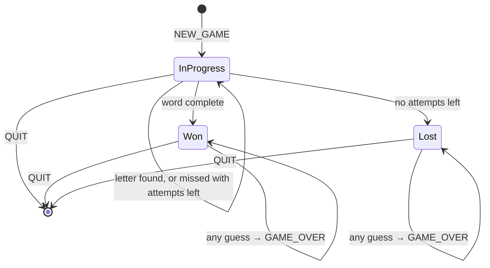

# Hangman

A multiplayer Hangman game server in Go. Clients connect over TCP and exchange one JSON object per line. Every connection is handled in its own goroutine, and games live in a shared, mutex-protected session store, so many players can play at the same time.

## Quick start

Requires Go 1.27.

```bash
go run ./cmd/server          # listens on :8080
```

In another terminal:

```bash
nc localhost 8080
{"action":"NEW_GAME","player":"Alice"}
```

Copy the `session_id` from the response and keep playing:

```json
{"action":"LETTER","session_id":"<id>","letter":"e"}
{"action":"RESUME","session_id":"<id>"}
{"action":"QUIT","session_id":"<id>"}
```

## Protocol

Each request and each response is a single JSON line terminated by `\n`.

### Requests

| Action | Fields | Effect |
|---|---|---|
| `NEW_GAME` | `player` | Creates a game with a random word and 6 attempts |
| `LETTER` | `session_id`, `letter` | Guesses one letter |
| `RESUME` | `session_id` | Returns the current state of a game, for example after reconnecting |
| `QUIT` | `session_id` | Abandons the game, reveals the word, deletes the session and closes the connection |

Actions are case-insensitive.

### Responses

| `type` | When | Notable fields |
|---|---|---|
| `STATE` | A game was created, played or resumed | `masked_word`, `attempts_left`, `tried_letters`, `status` (`IN_PROGRESS`, `WON` or `LOST`), plus `secret_word` once the game is over |
| `BYE` | After `QUIT` | `status: ABANDONED`, `secret_word` |
| `ERROR` | The request was rejected | `code` and `message` |

### Error codes

| Code | Meaning |
|---|---|
| `INVALID_FORMAT` | The line isn't valid JSON, or `player` is missing. The connection stays open. |
| `UNKNOWN_ACTION` | The action doesn't exist |
| `SESSION_NOT_FOUND` | `session_id` is missing or doesn't match any game |
| `INVALID_LETTER` | `letter` isn't exactly one alphabetic character |
| `LETTER_ALREADY_TRIED` | The letter was already guessed (case-insensitive). No attempt is lost. |
| `GAME_OVER` | The game is already won or lost |

### Example

```
→ {"action":"NEW_GAME","player":"Alice"}
← {"type":"STATE","session_id":"IFSWSFNNPZJYC5QRMSS5MX3PZ7","masked_word":"_ _ _ _ _","attempts_left":6,"tried_letters":[],"status":"IN_PROGRESS","message":"Partie lancée pour Alice !"}
→ {"action":"LETTER","session_id":"IFSWSFNNPZJYC5QRMSS5MX3PZ7","letter":"a"}
← {"type":"STATE","session_id":"IFSWSFNNPZJYC5QRMSS5MX3PZ7","masked_word":"_ _ A _ _","attempts_left":6,"tried_letters":["A"],"status":"IN_PROGRESS","message":"Bien vu !"}
```

## Architecture

```
cmd/server         wires everything together and starts the server
internal/network   TCP server: one goroutine per connection, line-based JSON I/O, logging
internal/command   dispatcher: routes an action name to its handler
  └─ handlers      one handler per action, plus the SessionStore interface
internal/game      game rules: GameSession, its states, the in-memory SessionManager, the word list
internal/protocol  request and response types shared by every layer
```

Dependencies point one way: `network` → `command` → `handlers` → `game` → `protocol`.

### Class diagram

```mermaid
classDiagram
    direction LR

    class TCPServer {
        -address string
        -listener net.Listener
        -dispatcher *CommandDispatcher
        +Start() error
        +Stop() error
        -handleConnection(conn)
    }
    class ClientConnection {
        -conn net.Conn
        -scanner *bufio.Scanner
        -sessionID string
        +ReadCommand() CommandRequest, error
        +SendResponse(CommandResponse) error
        +Close() error
    }

    class CommandDispatcher {
        -handlers map[string]CommandHandler
        +Register(action, handler)
        +Dispatch(CommandRequest) CommandResponse
    }
    class CommandHandler {
        <<interface>>
        +Handle(CommandRequest) CommandResponse
    }
    class NewGameHandler {
        +Sessions SessionStore
    }
    class GuessLetterHandler {
        +Sessions SessionStore
    }
    class ResumeHandler {
        +Sessions SessionStore
    }
    class QuitHandler {
        +Sessions SessionStore
    }
    class SessionStore {
        <<interface>>
        +Add(*GameSession)
        +Get(id) *GameSession, bool
        +Remove(id)
    }

    class SessionManager {
        -mu sync.Mutex
        -sessions map[string]*GameSession
        +Add(*GameSession)
        +Get(id) *GameSession, bool
        +Remove(id)
    }
    class GameSession {
        -mu sync.Mutex
        -id string
        -player string
        -secretWord string
        -maskedWord string
        -attemptsLeft int
        -triedLetters []string
        -currentState GameState
        +Guess(letter) CommandResponse
        +Snapshot() CommandResponse
    }
    class StateSession {
        <<interface>>
        +ID() string
        +SecretWord() string
        +MaskedWord() string
        +AttemptsLeft() int
        +TriedLetters() []string
        +SetState(GameState)
        +DecrementAttempts()
        +AddTriedLetter(letter)
        +UpdateMaskedWord()
        +IsWordComplete() bool
    }
    class GameState {
        <<interface>>
        +Guess(StateSession, letter) CommandResponse
        +GetStatus() string
    }
    class InProgressState
    class WonState
    class LostState

    TCPServer --> CommandDispatcher : dispatches to
    TCPServer ..> ClientConnection : one per client
    CommandDispatcher o-- CommandHandler : action → handler

    CommandHandler <|.. NewGameHandler
    CommandHandler <|.. GuessLetterHandler
    CommandHandler <|.. ResumeHandler
    CommandHandler <|.. QuitHandler

    NewGameHandler --> SessionStore
    GuessLetterHandler --> SessionStore
    ResumeHandler --> SessionStore
    QuitHandler --> SessionStore

    SessionStore <|.. SessionManager
    SessionManager o-- GameSession : stores by ID

    StateSession <|.. GameSession
    GameSession --> GameState : current state
    GameState <|.. InProgressState
    GameState <|.. WonState
    GameState <|.. LostState
```



Go has no `implements` keyword: each dotted arrow is an interface the type satisfies implicitly, by having its methods. `handlers.RegisterAll` creates the four handlers and injects one shared `SessionStore` into all of them.

### Game states

The game uses the State pattern. `GameSession.Guess` never checks whether the game is over; it delegates to its current state, and a finished state rejects every guess.



### Concurrency

- **`SessionManager.mu`** protects the map of sessions. It is held only while the map is read or written, so players in different games never wait for each other.
- **`GameSession.mu`** protects one game. Outside the session, the only methods that read or change mutable state are `Guess()` and `Snapshot()`, and both take the lock. The plain getters are meant for the states, which run while `Guess()` already holds the lock.
- Fields that never change after creation (`id`, `player`, `secretWord`) are safe to read without the lock.

## Testing

```bash
go test ./...
```

| Test file | Covers |
|---|---|
| `internal/game/session_test.go` | Winning, losing, attempts, duplicates, accented letters, hyphens, `Snapshot`, `TriedLetters` returning a copy |
| `internal/game/manager_test.go` | Add, Get and Remove; 100 concurrent `Add` calls |
| `internal/network/client_conn_test.go` | Reading valid and invalid JSON over an in-memory connection (`net.Pipe`) |
| `internal/command/dispatcher_test.go` | Each action through the dispatcher, including error cases |
| `internal/command/concurrency_test.go` | 100 concurrent games; one game guessed from many goroutines at once |

### Race detector

The concurrency tests are meant to run with Go's race detector, which needs cgo and a C compiler:

```bash
sudo apt install gcc                     # once
CGO_ENABLED=1 go test -race ./...
```

### Load simulation

`scripts/simulate.sh` plays N games in parallel against a running server, one TCP connection per player, and fails if any game errors, doesn't finish, or if the server stops responding.

```bash
go run ./cmd/server                      # terminal 1
scripts/simulate.sh 200                  # terminal 2 (default: 20 players)
```

For the strongest check, run the server with the race detector while the script runs:

```bash
CGO_ENABLED=1 go run -race ./cmd/server
```

## Logging

The server logs with `log/slog`: one line when a client connects or disconnects, and one line per request with the session ID, the response type and code, and the duration. Invalid JSON is logged at `WARN` level. The secret word is never logged.

```
INFO request remote=127.0.0.1:40746 action=NEW_GAME session=YKZ6YDL3OUCVYLMRBEZWB45JAP type=STATE status=IN_PROGRESS code="" duration=39.331µs
WARN invalid request remote=127.0.0.1:40746 err="INVALID_FORMAT: invalid character 'h' looking for beginning of value"
```

To follow one game: `grep <session_id>`.

## Status

### Implemented

- TCP server with one goroutine per connection
- JSON line protocol, with an error response instead of a dropped connection on invalid input
- Protection against abusive clients: 4 KB maximum line length, 5-minute idle timeout
- `NEW_GAME`, `LETTER`, `RESUME` and `QUIT`, all backed by real sessions
- Game rules through the State pattern (in progress, won, lost)
- Case-insensitive guesses, accented letters, and non-letters such as `-` shown from the start
- Random session IDs from `crypto/rand`, and random words
- Thread-safe in-memory session store, behind a `SessionStore` interface
- Games survive a disconnect: reconnect and `RESUME`
- Structured logging with session IDs
- Unit, integration and concurrency tests, and a multi-player load script

### Not implemented yet

- **Persistence:** games are kept in memory only and are lost when the server restarts. A SQLite store implementing `SessionStore` is planned, using `modernc.org/sqlite`, which doesn't need cgo.
- **Session ownership:** anyone who knows a session ID can play or quit that game. `ClientConnection` records the session ID but never checks it.
- **Expiry of abandoned games:** a game that is never quit stays in memory forever.
- **Graceful shutdown:** `Stop()` makes `Start()` return an error, which `main` treats as fatal.
- **Configuration:** the port (`:8080`) and the number of attempts (6) are hard-coded.
- **Word list:** a short, hard-coded list of English words.
- **Constants for protocol strings:** `"STATE"`, `"ERROR"`, `"BYE"` and the error codes are written as literals in several places.
- **Client program:** there is no dedicated client yet; use `nc`.
- **A dedicated `RESUME` test:** `RESUME` is covered indirectly by the `QUIT` and concurrency tests.
- **The race detector has not been run yet,** because the development machine has no C compiler.
