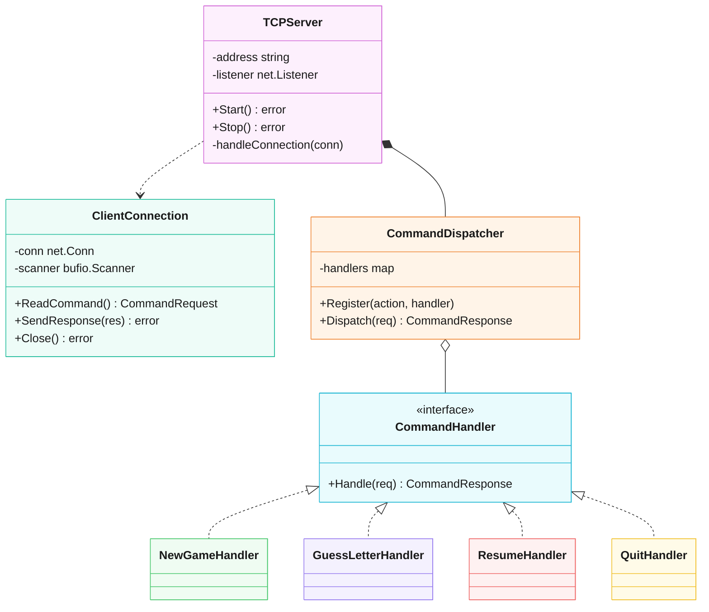
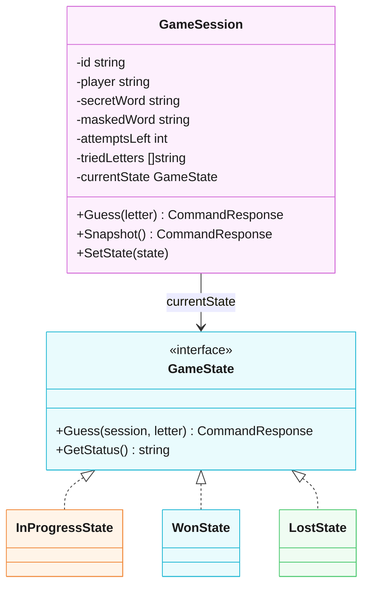
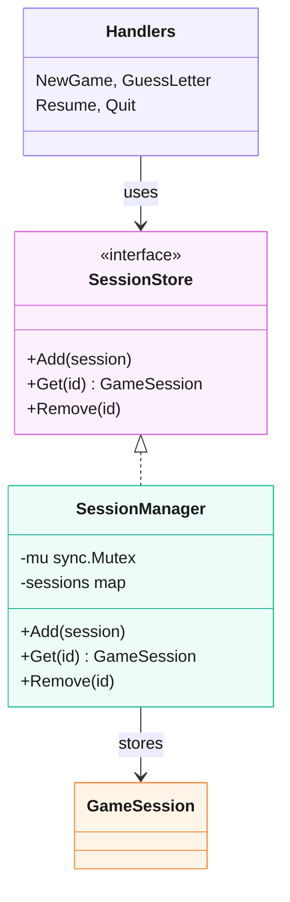

# Hangman

Multiplayer Hangman server in Go. TCP, one JSON object per line, one goroutine per client.

## Run

Listens on IPv4 and IPv6 (`:5050` is dual-stack): `nc 127.0.0.1 5050` and `nc ::1 5050` both work.

```bash
go run ./cmd/server        # :8080
nc localhost 8080
```

```json
{"action":"NEW_GAME","player":"Alice"}
{"action":"LETTER","session_id":"<id>","letter":"e"}
{"action":"RESUME","session_id":"<id>"}
{"action":"QUIT","session_id":"<id>"}
```

With Docker (image built by CI on every push to `main`):

```bash
docker run --rm -p 8080:8080 ghcr.io/ainzooalgownfer/hangman:latest
```

Update: `docker pull ghcr.io/ainzooalgownfer/hangman:latest`

Build locally instead: `docker compose up --build`

## Configuration

Read at startup from the working directory. Both files are optional; missing values fall back to the defaults in `internal/config`. An invalid value stops the server with an error.

| File | Content |
| --- | --- |
| `config.yaml` | address, max line size, idle timeout, max attempts, session TTL, words file path |
| `words.json` | JSON array of words |

Durations take a unit: `30s`, `5m`, `1h`.

In Docker both files are in `/app`. To override them:

```bash
docker run --rm -p 8080:8080 \
  -v ./config.yaml:/app/config.yaml \
  -v ./words.json:/app/words.json \
  ghcr.io/ainzooalgownfer/hangman:latest
```

## Protocol

| Action | Fields | Response |
| --- | --- | --- |
| `NEW_GAME` | `player` | `STATE` + `resume_token` (only here) |
| `LETTER` | `session_id`, `letter` | `STATE` (`IN_PROGRESS`, `WON`, `LOST`) |
| `RESUME` | `session_id`, `resume_token` | `STATE`; the game moves to this connection |
| `QUIT` | `session_id` | `BYE` (`ABANDONED`, `secret_word`), then the connection closes |

Every request may carry a `request_id` (an integer ≥ 1, new for each request). It is echoed in the response. If the last `LETTER` or `QUIT` is sent again with the same `request_id`, the server sends back the same answer with `"replayed": true` instead of playing it twice.

A game belongs to the connection that created or resumed it. `LETTER` and `QUIT` from another connection are refused.

Errors: `{"type":"ERROR","code":"...","message":"..."}`

| Code | When |
| --- | --- |
| `INVALID_MESSAGE` | invalid JSON, line too long, or missing `player` |
| `UNKNOWN_ACTION` | unknown action |
| `UNKNOWN_SESSION` | missing, unknown or expired `session_id` |
| `PLAYER_NOT_ALLOWED` | wrong `resume_token`, or the game belongs to another connection |
| `INVALID_LETTER` | not a single letter |
| `ALREADY_GUESSED` | letter already guessed |
| `INVALID_STATE` | `LETTER` or `QUIT` on a game already won, lost or abandoned |
| `TIMEOUT` | no message for `idle_timeout`; the connection then closes |

## Structure

```
cmd/server         entry point
internal/network   TCP server, connections, logging
internal/command   dispatcher
  handlers         one handler per action, SessionStore interface
internal/game      GameSession, SessionManager
  state            GameState + the 4 states (State pattern)
  words            word list, accents (BaseLetter)
internal/protocol  request/response types
scripts            load simulation
```

## Class diagrams

### Server and commands



### Game session and State pattern



### Session store



### Patterns

| Pattern | Classes |
| --- | --- |
| Command / Handler registry | `CommandDispatcher`, `CommandHandler`, handlers |
| State | `GameSession`, `GameState`, `InProgressState`, `WonState`, `LostState` |
| Repository | `SessionStore`, `SessionManager` |

## Tests

```bash
go test ./...
CGO_ENABLED=1 go test -race ./...    # needs gcc
```

Load test against a running server:

```bash
scripts/simulate.sh 200
```

## Status

Done:

- NEW_GAME, LETTER, RESUME, QUIT
- State pattern for game rules
- Thread-safe in-memory session store
- Resume after disconnect
- Input limits: 4 KB per line, 5 min idle timeout
- Structured logs (`log/slog`) with session IDs
- Unit, concurrency and load tests

TODO:

- SQLite persistence
- Check that a session belongs to the connection using it
- Expire abandoned sessions
- Graceful shutdown
- Config tests (config_test.go)
- ResponseFactory
- Leaderboard
