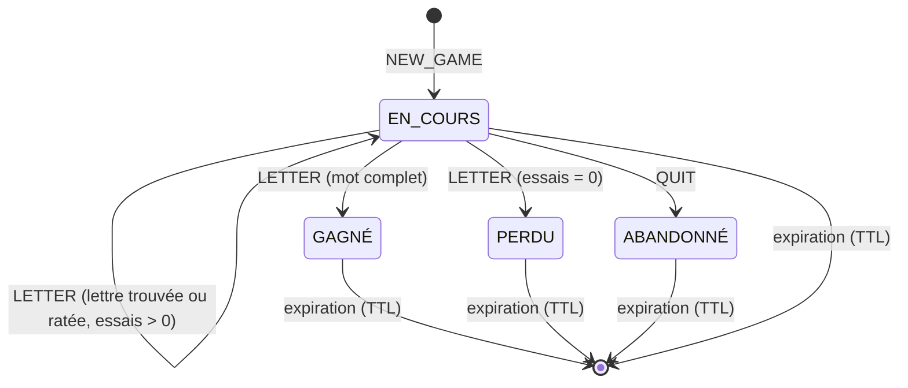
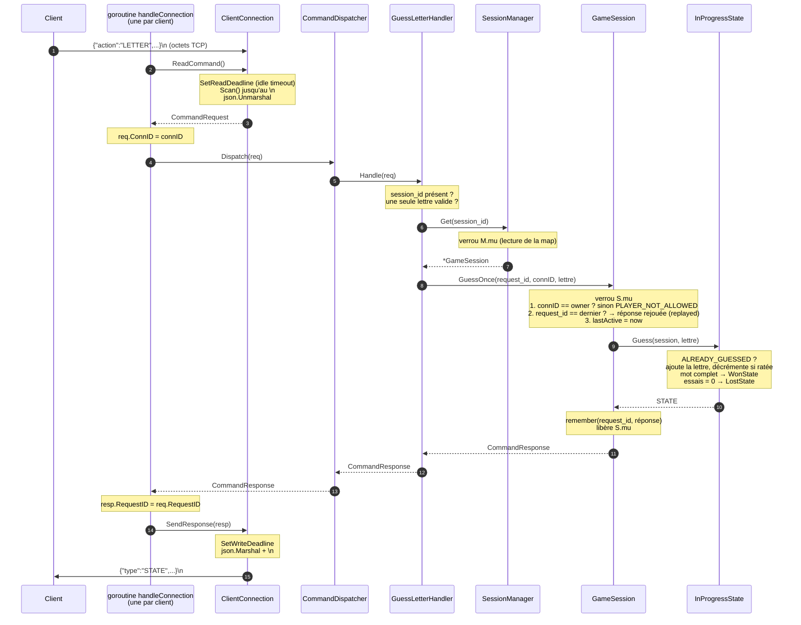

# Architecture du serveur

Diagrammes générés à partir du code (commit `5ce8d34`). GitHub affiche les blocs Mermaid directement.

## 2. Classes principales

```mermaid
%%{init: {"class": {"curve": "stepAfter"}}}%%
classDiagram
    direction LR

    class TCPServer {
        -listener net.Listener
        -dispatcher *CommandDispatcher
        -nextConnID atomic.Int64
        +Start() error
        +Server() error
        +Stop() error
        -handleConnection(conn)
    }
    class ClientConnection {
        -conn net.Conn
        -scanner *bufio.Scanner
        -idleTimeout
        +ReadCommand() CommandRequest
        +SendResponse(resp) error
    }
    class CommandDispatcher {
        -handlers map[string]CommandHandler
        +Register(action, handler)
        +Dispatch(req) CommandResponse
    }
    class CommandHandler {
        <<interface>>
        +Handle(req) CommandResponse
    }
    class NewGameHandler
    class GuessLetterHandler
    class ResumeHandler
    class QuitHandler

    class SessionStore {
        <<interface>>
        +Add(s)
        +Get(id) GameSession, bool
        +Remove(id)
    }
    class SessionManager {
        -mu sync.Mutex
        -sessions map[string]*GameSession
        +RemoveExpired(now, ttl) int
        +StartJanitor(ttl, interval) stop
    }
    class GameSession {
        -mu sync.Mutex
        -currentState GameState
        -resumeToken
        -owner int64
        -lastRequestID / lastResponse
        +GuessOnce(requestID, connID, letter)
        +QuitOnce(requestID, connID)
        +Claim(connID)
        +Snapshot()
    }
    class StateSession {
        <<interface>>
        +SetState(GameState)
        +AddTriedLetter(letter)
        +DecrementAttempts()
        ...
    }
    class GameState {
        <<interface>>
        +Guess(session, letter)
        +Quit(session)
        +GetStatus() string
    }
    class InProgressState
    class WonState
    class LostState
    class AbandonedState

    TCPServer --> ClientConnection : une par client
    TCPServer --> CommandDispatcher
    CommandDispatcher o-- CommandHandler
    CommandHandler <|.. NewGameHandler
    CommandHandler <|.. GuessLetterHandler
    CommandHandler <|.. ResumeHandler
    CommandHandler <|.. QuitHandler
    NewGameHandler --> SessionStore
    GuessLetterHandler --> SessionStore
    ResumeHandler --> SessionStore
    QuitHandler --> SessionStore
    SessionStore <|.. SessionManager
    SessionManager o-- GameSession
    StateSession <|.. GameSession
    GameSession --> GameState : état courant
    GameState <|.. InProgressState
    GameState <|.. WonState
    GameState <|.. LostState
    GameState <|.. AbandonedState
```

Patrons utilisés : **Command** (dispatcher + un handler par action), **State** (un objet par état de partie, pas de `if partieFinie`), **Repository** (`SessionStore` / `SessionManager`).

## 3. Machine à états d'une partie

Messages autorisés dans chaque état :

| État | `LETTER` | `QUIT` | `RESUME` |
|---|---|---|---|
| `IN_PROGRESS` |  `STATE` (ou `INVALID_LETTER`, `ALREADY_GUESSED`) |  `BYE` |  `STATE` |
| `WON` |  `INVALID_STATE` |  `INVALID_STATE` |  `STATE` + `secret_word` |
| `LOST` |  `INVALID_STATE` |  `INVALID_STATE` |  `STATE` + `secret_word` |
| `ABANDONED` |  `INVALID_STATE` |  `INVALID_STATE` |  `STATE` + `secret_word` |
| expirée / inconnue | `UNKNOWN_SESSION` | `UNKNOWN_SESSION` | `UNKNOWN_SESSION` |

Dans tous les états, `LETTER` et `QUIT` envoyés depuis une autre connexion que le propriétaire donnent `PLAYER_NOT_ALLOWED`, et `RESUME` sans le bon `resume_token` aussi.

## 4. Parcours d'un `LETTER`

Ordre des verrous : toujours `SessionManager.mu` puis `GameSession.mu`, jamais l'inverse. Ici `M.mu` est déjà relâché quand `S.mu` est pris.